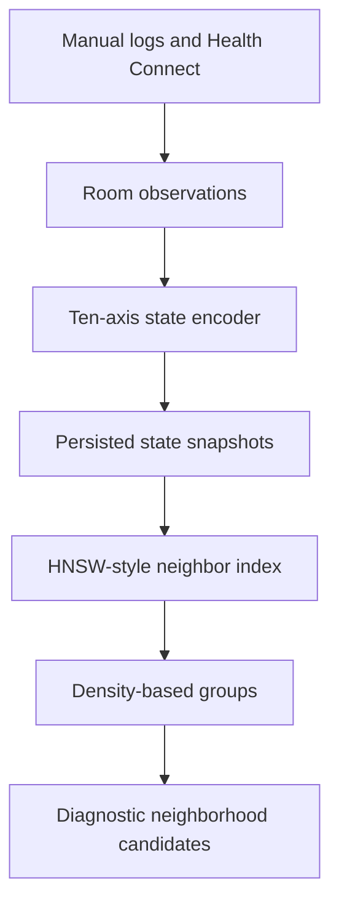

# ORBIT

An Android application for local behavioral logging and experimental analysis of observations over time. Written in Kotlin with Jetpack Compose, Room, SQLCipher, coroutines, WorkManager, and Health Connect integration.

ORBIT combines a working logging application with a developing state-space analysis pipeline. It is an independent engineering prototype; its clustering and suggestion heuristics have not been validated as clinical or causal models.

## Implemented application

- Mood check-ins, journal entries, activities, meals, exercise, sleep, and medication/substance-use logs.
- Local history and trend views, configurable lists, and reminders.
- SQLCipher-encrypted Room database, with a passphrase protected using Tink and Android Keystore. This describes the database, not every preference or diagnostic output.
- Optional Health Connect reads for biometric inputs. State encoding can also run from existing local observations without a new Health Connect pull.
- Barcode scanning and Open Food Facts lookups for food information.
- User-initiated status sharing by SMS to configured contacts. Inbound SMS triggers are disabled in the current implementation.

The application is local-first, not network-free: food lookups and optional SMS sharing communicate outside the device. No account-based cloud backend is included in this source.

## Experimental analysis



- A fixed ten-axis vector normalizes selected observations to 0–1.
- A presence bitmask distinguishes missing sources from neutral numeric fill. Distance uses only axes present in both vectors and returns infinity for no overlap.
- A custom HNSW-style index supports approximate neighbor lookup over a rolling 90-day working window.
- Core distances and a mutual-reachability threshold support incremental merging. A weekly compaction job rebuilds the index and recomputes grouping.
- `NeighborhoodSuggester` selects candidate higher-mood neighborhoods, with dense-group, sparse-neighbor, and learning-message paths. This logic is exercised by tests and a debug diagnostic flow, not a complete user-facing recommendation experience.

The implementation is a custom density-based grouping heuristic. It does not implement or claim a full HDBSCAN pipeline.

See [the architecture and feature definition](docs/architecture.md) and [source review notes](docs/source-review.md) for exact scope and open evaluation questions.

## Build and run

Use Android Studio with JDK 17, Android SDK platform 36, and a device or emulator running Android 8.0 / API 26 or newer. Configure the SDK through Android Studio or your own untracked `local.properties`.

```sh
chmod +x gradlew
./gradlew assembleDebug
```

The wrapper pins Gradle 8.11.1. SDK and dependency downloads require network access. Health Connect availability and permissions depend on the test device; logging and manual state encoding can be explored separately.

## Tests

```sh
./gradlew testDebugUnitTest
```

The supplied source contains nine JUnit tests in two classes:

- `NeighborhoodSuggesterTest`: six tests covering dense and sparse selection, missing mood, and insufficient-history behavior.
- `SyntheticTopologyHarnessTest`: three tests covering synthetic regime generation, an insertion timing smoke check, and a known distance relationship.

These tests do not establish real-world prediction quality, causation, device performance, or correct temporal encoding. The timing smoke check is not a reproducible performance benchmark.

Review environment: Android execution and JUnit reruns were not completed. The review container has no Android SDK, and the Gradle wrapper could not download its distribution. Existing tests were inspected, not reported as passing.

## Repository map

| Path under `app/src/main/java/com/orbit/wellness` | Responsibility |
| --- | --- |
| `ui/` | Compose screens and ViewModels |
| `data/local/` | Room entities, DAOs, schema migrations, and database key management |
| `data/biometrics/` | Health Connect access and encoding orchestration |
| `domain/state/` | Feature axes, normalization, and state snapshot conversion |
| `domain/topology/` | Neighbor index, grouping, synthetic fixtures, and diagnostic suggestion logic |
| `worker/` | Periodic synchronization, reminders, and topology compaction |
| `data/sharing/` | Configured SMS sharing and share records |

Room schema JSON files are included as source documentation. Machine-local configuration, build outputs, dependency caches, and application databases are excluded from the repository package.

## Synthetic demonstration

The debug-only Profile control seeds 800 synthetic snapshots in the same database used by the app, then compacts and evaluates a probe. Use a fresh emulator or disposable app installation for this demonstration. It is not a separate sandbox database.

## Contributions

Project by Jacob Patrick Noe, developed with AI collaboration. Specific implementation and debugging contributions should be recorded with the relevant changes. This package adds documentation, repository hygiene, and an explicit non-null value in one test; it preserves the application and analysis implementation supplied for review.
